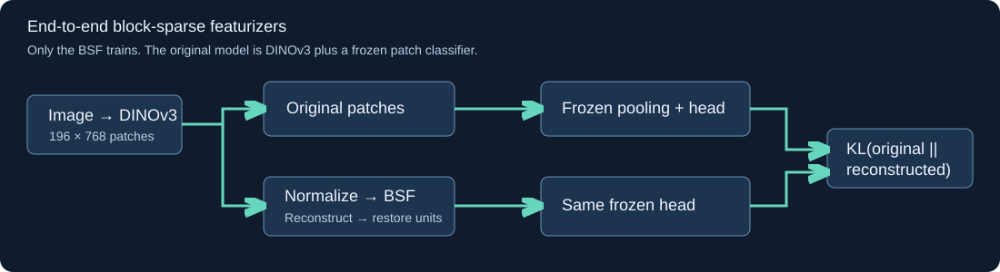

# End-to-End Block-Sparse Featurizers for Vision

Train a **Grassmannian block-sparse featurizer from scratch** to preserve the class probabilities
of a frozen DINOv3 + Imagenette classifier. The pipeline extracts final patch activations, replaces
them with BSF reconstructions, and minimizes `KL(original || reconstructed)`. Only the BSF updates.
It combines [Goodfire's BSFs](https://arxiv.org/abs/2606.25234) with
[Apollo's end-to-end objective](https://arxiv.org/abs/2405.12241).



**Full-study status, 2026-10-27:** all 30 pilots finished. The power target requires six seeds, but
only five fit the original compute budget. The registered next stage is exploratory: five paired
seeds, one epoch per condition, estimated power 77.5%. The original deadline remains
2026-10-28 01:02 UTC. See the [pilot results and recovery amendment](reports/study/pilot.md).
The measured results below remain the completed engineering smoke study; full test results are pending.

<!-- measured-results:start -->

**Engineering smoke experiment: one seed, small data and dictionary; no confirmatory claim.**

Mean paired local-minus-KL difference: 0.115604 nats/image over 1 seed(s). KL training had lower mean output divergence. A seed-level confidence interval cannot be estimated from one seed.

| Condition | Seeds | Test KL (nats/image) | Accuracy | NMSE | Active blocks | Dead blocks |
|---|---:|---:|---:|---:|---:|---:|
| Block KL + 0.1 MSE | 1 | 5.75317 | 14.00% | 0.96633 | 4 | 0.00% |
| Block KL | 1 | 5.75244 | 14.00% | 0.96635 | 4 | 0.00% |
| Block MSE | 1 | 5.86805 | 10.00% | 0.96103 | 4 | 0.00% |
| Scalar KL | 1 | 5.13261 | 26.00% | 0.94416 | 12 | 0.00% |
| Scalar MSE | 1 | 5.3282 | 26.00% | 0.937 | 12 | 0.00% |

| Control | Test KL (nats/image) | Accuracy | NMSE |
|---|---:|---:|---:|
| identity | 0 | 100.00% | 0 |
| mean | 6.98686 | 10.00% | 1.0087 |
| untrained | 6.02086 | 10.00% | 0.96988 |


[Detailed results and limitations](reports/smoke/summary.md) · [PDF paper](reports/smoke/paper.pdf) · [Interactive explorer](https://burnycoder.github.io/end-to-end-block-sparse-featurizers/)

<!-- measured-results:end -->

The smoke experiment verifies execution, not effectiveness: its tiny dictionaries retain only
10–26% test accuracy, versus 100% for the clean teacher on those 50 images. KL training reduces
divergence slightly while increasing reconstruction error. The full preregistered study is separate;
all smoke-preview test groups are excluded from its test set. See the [experiment ledger](reports/experiments.md).
The five engineering artifacts and their fitted classifiers are available in the
[Hugging Face smoke collection](https://huggingface.co/collections/BurnyCoder/end-to-end-bsfs-on-dinov3-smoke-6adff6caaaf7fa9377f043d1).

## Method and use

The teacher is a **new frozen ten-class patch classifier on DINOv3**, not a native DINO class head.
The selected Grassmannian implementation uses signed codes, QR-orthonormal blocks and block TopK.
Main settings are 4096 blocks × 3 coordinates, 16 active blocks. Scalar controls match total width
and 48 active coordinates. Local-MSE and KL runs share initializations and image order.
The primary and scalar featurizers have 9,441,280 and 9,449,472 trainable parameters respectively:
both contain 9,437,184 chart coefficients, with 4,096 versus 12,288 learned gains. Smoke counts
are 73,760 and 73,824. Exact instantiated counts are saved with every evaluation.
The complete scientific specification is in [the preregistration](docs/preregistration.md).

Requirements: Git, [uv](https://docs.astral.sh/uv/), Python 3.12 (managed by uv), an NVIDIA GPU with a
CUDA-13-compatible driver for the Windows lockfile, approximately 15 GB workspace storage, and
authorized access to [DINOv3](https://huggingface.co/facebook/dinov3-vitb16-pretrain-lvd1689m).
The tested target is an 8 GB RTX 5070 Laptop GPU; actual measurements are reported after execution.

```powershell
git clone https://github.com/BurnyCoder/end-to-end-block-sparse-featurizers.git
cd end-to-end-block-sparse-featurizers
uv sync --frozen
Copy-Item .env.example .env
uv run hf auth login
uv run pytest
uv run e2e-bsf run --profile smoke
uv run e2e-bsf run --profile full
```

Accept the model's access terms through its Hugging Face page. Existing `hf` login is supported;
an optional `HF_TOKEN` belongs only in ignored `.env`. Never paste credentials into commands/logs.
On Linux/macOS use `cp .env.example .env`; set `E2E_DEVICE=cpu` only for tests/small diagnostics.
Check the installed Torch build before using a different GPU/platform.

Individual phases use the same artifacts:

```powershell
uv run e2e-bsf prepare --profile smoke
uv run e2e-bsf train --profile smoke --condition block_kl --seed 100
uv run e2e-bsf evaluate --profile smoke
uv run e2e-bsf report --profile smoke
uv run e2e-bsf verify --profile smoke
uv run e2e-bsf publish --profile smoke
```

Images are hashed/grouped before splitting. The training split fits normalization and classifier;
development chooses the classifier and pilot settings. Extraction creates an approximately 8 GB
float32 full-dataset cache. Subsequent BSF training reads image batches from that cache and does
not rerun DINO. Predictions/code moments are streamed; complete dense latent datasets are not saved.
See [artifact contracts](docs/methodology.md) for cache/checkpoint details.

`run --profile full` executes the equal pilot grid, freezes the seed/epoch schedule, trains all five
conditions, and evaluates once. Rerunning resumes saved state without resetting the 24-hour deadline.
Publication is explicit: `uv run e2e-bsf publish --profile full` uploads all evaluated conditions
to a Hugging Face collection. Use an HF account with write permission. Generated reports and `site/`
are committed to GitHub; the included Pages workflow deploys the explorer from `main`.

## Features and technologies

- PyTorch/CUDA, Transformers/DINOv3, torchvision/Imagenette, scikit-learn probe and grouped splits.
- Five matched training conditions, deterministic resume, partial-batch handling and memory backoff.
- Paired-seed inference, clustered image bootstrap, identity/mean/random controls and intervention plots.
- Timestamped sanitized terminal/file logs; complete predictions and machine-readable provenance.
- Generated Markdown reports, a PDF paper, and a static interactive GitHub Pages results explorer.
- Hugging Face checkpoint/model-card collection; original photos and gated backbone weights stay external.

Source revisions, reuse, and paper/code discrepancies are listed in the
[literature review](docs/literature-review.md). Full compute is bounded to 24 hours, with a separate
small engineering smoke run. No LLM API or paid cloud service is needed.

## Interpretation limits

Lower KL supports fidelity to this frozen ten-class readout. It does **not** establish that all
DINO information or visual concept manifolds survive. Images may overlap unknown backbone pretraining
data; this study holds out data for the probe/featurizer, not for original DINO training. The BSF uses
dense matrix operations, so block-sparse codes do not imply faster inference.
