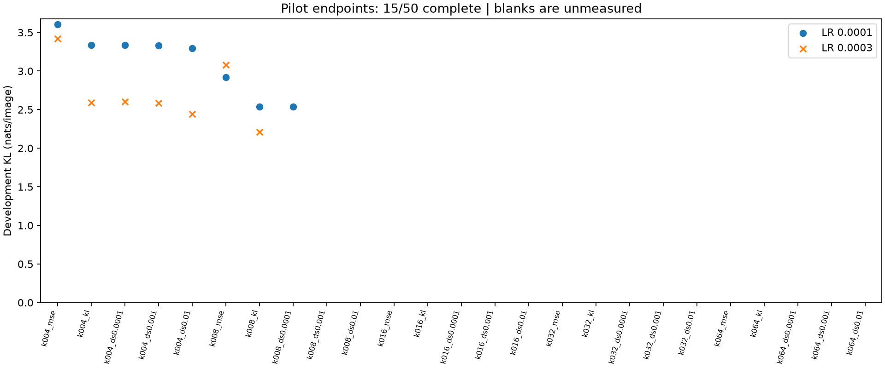
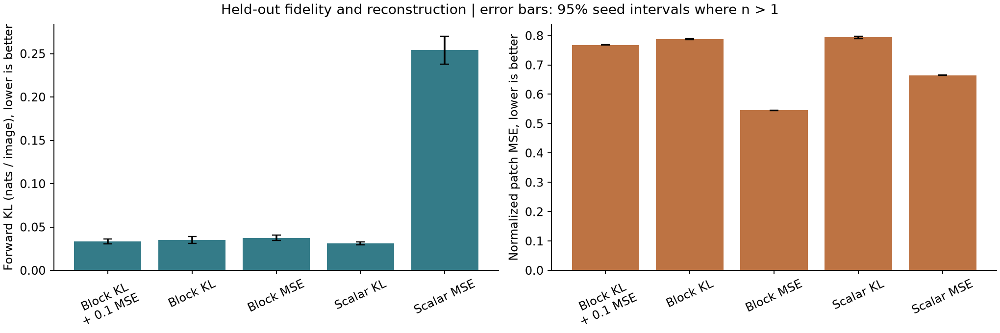
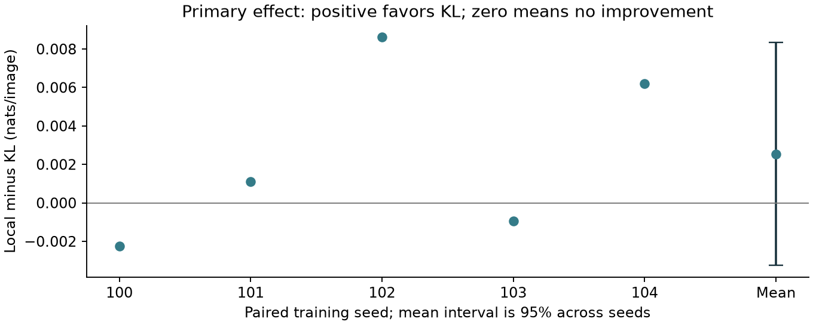
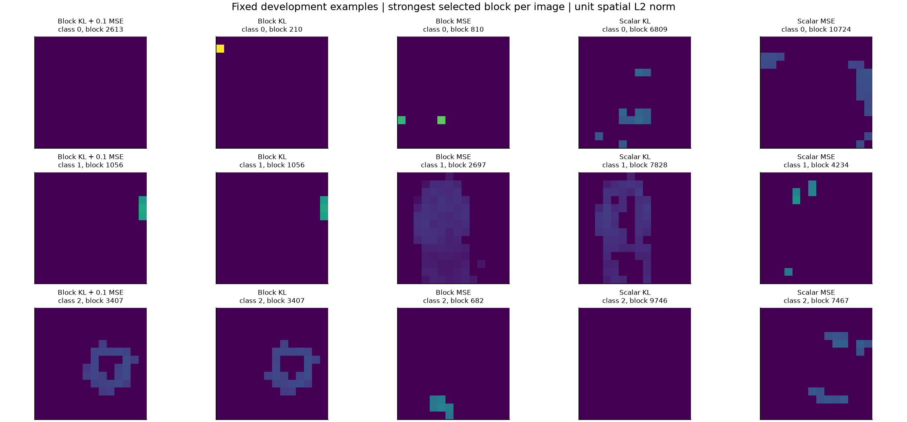

# End-to-End Block-Sparse Featurizers for Vision

Train a **Grassmannian block-sparse featurizer from scratch** to preserve the class probabilities
of a frozen DINOv3 + Imagenette classifier. The pipeline extracts final patch activations, replaces
them with BSF reconstructions, and minimizes `KL(original || reconstructed)`. Only the BSF updates.
It combines [Goodfire's BSFs](https://arxiv.org/abs/2606.25234) with
[Apollo's end-to-end objective](https://arxiv.org/abs/2405.12241).


**Follow-up allocation failure, 2026-10-27:** the [block-6 downstream reconstruction and sparsity sweep](docs/downstream-preregistration.md)
stopped at its two-hour preparation deadline. Extraction, training-only normalization and hashing finished;
real-image verification passed after a documented batch-size repair. Only **15/50 pilots completed**;
a 16th trained but lacked its development endpoint. **0/25 main runs** and **zero new test evaluations** ran.
No main learning rates, curve advantage, uncertainty interval or sparsity saving was estimated. This
is an execution failure, not evidence against KL training. The original final-layer results below remain unchanged.

| Follow-up objective | Planned sparsities k | Main test KL |
|---|---|---|
| Local normalized MSE | 4, 8, 16, 32, 64 | Unmeasured |
| Output KL | 4, 8, 16, 32, 64 | Unmeasured |
| KL + downstream MSE, beta=0.0001 / 0.001 / 0.01 | 4, 8, 16, 32, 64 each | Unmeasured |



[Failure report and all pilot records](reports/downstream-sweep/summary.md) · [Separate paper](reports/downstream-sweep/paper.pdf) ·
[Interactive pilot explorer](https://burnycoder.github.io/end-to-end-block-sparse-featurizers/sweep/) ·
[Independent audit](reports/downstream-sweep/audit.json) · [Execution notes](docs/downstream-execution-notes.md).
The proposed follow-up explicitly reuses the previously analyzed Imagenette test set and has one planned main seed.
No follow-up Hugging Face collection was created because no completed evaluated main model exists.

**Completed, 2026-10-27:** all 25 runs and 3,875-image test evaluations finished within the original
24-hour limit. Five paired seeds received one epoch each. The study is exploratory: the pilot-based
power estimate was 77.5%, below the 80% target, and training was short. Block KL reduced mean KL by
6.78%, but its paired interval spans zero. Reconstruction error increased by 44.41%.
See the [findings and independent audit](reports/study/findings.md) and
[disclosed pilot allocation amendment](reports/study/pilot.md).
The [plan completion checklist](docs/plan-completion.md) maps the requirements to verified artifacts and limitations.

Download all 25 BSFs, frozen classifiers and normalization statistics from the
[Hugging Face collection](https://huggingface.co/collections/BurnyCoder/end-to-end-bsfs-on-dinov3-full-6ae0a9d519d3d32881f784b8).
The [publication audit](reports/study/publication_verification.json) verifies every uploaded file and
real-image inference using downloaded block and scalar bundles. Original photos and DINO weights are external.

<!-- measured-results:start -->

**Bounded preregistered study; interpret completion and power status below. Exploratory: the pilot power target was not met.**

Mean paired local-minus-KL difference: 0.00254596 nats/image over 5 seed(s). KL training had lower mean output divergence. Seed-level 95% interval: [-0.00325909, 0.008351]. The interval includes zero; the directional comparison is inconclusive.

| Condition | Seeds | Test KL (nats/image) | Accuracy | NMSE | Active blocks | Dead blocks |
|---|---:|---:|---:|---:|---:|---:|
| Block KL + 0.1 MSE | 5 | 0.0334491 | 99.27% | 0.76812 | 16 | 0.00% |
| Block KL | 5 | 0.035026 | 99.37% | 0.78728 | 16 | 0.00% |
| Block MSE | 5 | 0.0375719 | 98.49% | 0.54515 | 16 | 0.00% |
| Scalar KL | 5 | 0.0309295 | 99.05% | 0.79378 | 48 | 0.00% |
| Scalar MSE | 5 | 0.254093 | 90.74% | 0.66437 | 48 | 0.00% |

| Control | Test KL (nats/image) | Accuracy | NMSE |
|---|---:|---:|---:|
| identity | 0 | 99.05% | 0 |
| mean | 3.71488 | 10.17% | 0.99943 |
| untrained | 0.734338 | 72.10% | 0.77609 |







[Detailed results and limitations](reports/study/summary.md) · [PDF paper](reports/study/paper.pdf) · [Interactive explorer](https://burnycoder.github.io/end-to-end-block-sparse-featurizers/)

<!-- measured-results:end -->

The secondary scalar comparison favored KL: mean output divergence fell from 0.25409 to 0.03093,
while reconstruction error rose. The mixed block objective had mean KL 0.03345, also with worse
reconstruction than local MSE. These results do not establish recovery of semantic concepts or
preservation of all DINO information. The separate [engineering smoke study](reports/smoke/summary.md)
and [experiment ledger](reports/experiments.md) retain the earlier positive and negative findings.
All smoke-preview test groups were excluded from the full study's test set.

**Comparison with Braun et al. (2024):**
[Sections 3.1–3.2 of *Identifying Functionally Important Features with End-to-End Sparse Dictionary Learning*](https://arxiv.org/html/2405.12241v2#S3.SS2)
report improved sparsity/performance tradeoffs in language-model SAEs despite worse activation
reconstruction. Our higher patch NMSE alongside lower mean output KL is qualitatively consistent
with this tradeoff, but our primary confidence interval includes zero: we have not reproduced their
broader performance or interpretability results. Their extra reconstruction penalty targets downstream
layers; our `KL + 0.1 MSE` targets insertion-layer patches, so these regularizers differ. Our fixed
sparsity and ten-class vision readout also differ from their sparsity sweeps. The
[paper's discussion](reports/study/paper.pdf) gives the numerical comparison and its limits.

## Method and use

The teacher is a **new frozen ten-class patch classifier on DINOv3**, not a native DINO class head.
The selected Grassmannian implementation uses signed codes, QR-orthonormal blocks and block TopK.
Main settings are 4096 blocks × 3 coordinates, 16 active blocks. Scalar controls match total width
and 48 active coordinates. Local-MSE and KL runs share initializations and image order.
The primary and scalar featurizers have 9,441,280 and 9,449,472 trainable parameters respectively:
both contain 9,437,184 chart coefficients, with 4,096 versus 12,288 learned gains. Smoke counts
are 73,760 and 73,824. Exact instantiated counts are saved with every evaluation.
The complete scientific specification is in [the preregistration](docs/preregistration.md).

Requirements: Git, [uv](https://docs.astral.sh/uv/), Python 3.12 (managed by uv), an NVIDIA GPU with a
CUDA-13-compatible driver for the Windows lockfile, approximately 15 GB workspace storage, and
authorized access to [DINOv3](https://huggingface.co/facebook/dinov3-vitb16-pretrain-lvd1689m).
The tested target is an 8 GB RTX 5070 Laptop GPU. The 25 main runs used 9.326 hours of training;
peak PyTorch-allocated VRAM was 699.3 MiB, excluding other applications and allocations outside PyTorch.

```powershell
git clone https://github.com/BurnyCoder/end-to-end-block-sparse-featurizers.git
cd end-to-end-block-sparse-featurizers
uv sync --frozen
Copy-Item .env.example .env
uv run hf auth login
uv run pytest
uv run e2e-bsf run --profile smoke
uv run e2e-bsf run --profile full
```

Accept the model's access terms through its Hugging Face page. Existing `hf` login is supported;
an optional `HF_TOKEN` belongs only in ignored `.env`. Never paste credentials into commands/logs.
On Linux/macOS use `cp .env.example .env`; set `E2E_DEVICE=cpu` only for tests/small diagnostics.
Check the installed Torch build before using a different GPU/platform.

Individual phases use the same artifacts:

```powershell
uv run e2e-bsf prepare --profile smoke
uv run e2e-bsf train --profile smoke --condition block_kl --seed 100
uv run e2e-bsf evaluate --profile smoke
uv run e2e-bsf report --profile smoke
uv run e2e-bsf verify --profile smoke
uv run e2e-bsf publish --profile smoke
```

Images are hashed/grouped before splitting. The training split fits normalization and classifier;
development chooses the classifier and pilot settings. Extraction creates an approximately 8 GB
float32 full-dataset cache. Subsequent BSF training reads image batches from that cache and does
not rerun DINO. Predictions/code moments are streamed; complete dense latent datasets are not saved.
See [artifact contracts](docs/methodology.md) for cache/checkpoint details.

`run --profile full` executes the equal pilot grid, freezes the seed/epoch schedule, trains all five
conditions, and evaluates once. Rerunning resumes saved state without resetting the 24-hour deadline.
Publication is explicit: `uv run e2e-bsf publish --profile full` uploads all evaluated conditions
to a Hugging Face collection. Use an HF account with write permission. Generated reports and `site/`
are committed to GitHub; the included Pages workflow deploys the explorer from `main`.

## Features and technologies

The separate intermediate-layer workflow uses the original prepared data and frozen readout:

```powershell
uv run e2e-bsf sweep run --spec configs/downstream-sweep.toml
uv run e2e-bsf sweep report --spec configs/downstream-sweep.toml
uv run e2e-bsf sweep publish --spec configs/downstream-sweep.toml
```

Its phases are `prepare`, `verify`, `pilot`, `train`, `evaluate`, `report`, and `publish`; `run` orchestrates
preparation through reporting. `train --cell k016_kl` advances only that cell of an already frozen schedule.
The default raw-state cache needs approximately **58 GB** under `D:/AI/end-to-end-block-sparse-featurizers/downstream-v1`.
Set `E2E_SWEEP_CACHE_DIR` in `.env` for another dedicated location. Additional overrides are
`E2E_SWEEP_ROOT`, `E2E_SWEEP_SOURCE_ROOT`, and `E2E_SWEEP_DEVICE`; paths and configuration are immutable after preparation starts.
The [sweep explorer](https://burnycoder.github.io/end-to-end-block-sparse-featurizers/sweep/) publishes measured results when available.
The recorded `downstream-v1` preparation allocation has expired; rerunning it does not restart the clock.
The 58 GB cache and all 16 pilot checkpoints remain local. A further scientific run requires an explicitly
registered amendment or a new allocation; this repository does not silently extend the stopped study.

- PyTorch/CUDA, Transformers/DINOv3, torchvision/Imagenette, scikit-learn probe and grouped splits.
- Five matched training conditions, deterministic resume, partial-batch handling and memory backoff.
- Paired-seed inference, clustered image bootstrap, identity/mean/random controls and intervention plots.
- Timestamped sanitized terminal/file logs; complete predictions and machine-readable provenance.
- Generated Markdown reports, a PDF paper, and a static interactive GitHub Pages results explorer.
- Hugging Face checkpoint/model-card collection; original photos and gated backbone weights stay external.

Source revisions, reuse, and paper/code discrepancies are listed in the
[literature review](docs/literature-review.md). Full compute is bounded to 24 hours, with a separate
small engineering smoke run. No LLM API or paid cloud service is needed.

## Interpretation limits

Lower KL supports fidelity to this frozen ten-class readout. It does **not** establish that all
DINO information or visual concept manifolds survive. Images may overlap unknown backbone pretraining
data; this study holds out data for the probe/featurizer, not for original DINO training. The BSF uses
dense matrix operations, so block-sparse codes do not imply faster inference.
