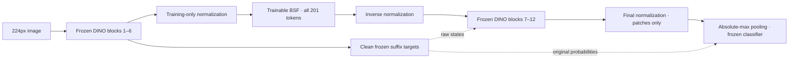

# Block-6 downstream reconstruction and sparsity sweep

Registered before the new study's extraction and optimization. This is a separate **24-hour
exploratory follow-up**, not an extension or reanalysis that changes the completed final-layer study.
The human selected the full grid, one training seed, all-token replacement and disclosed test reuse.

## Question, scope and falsifier

Does output-KL training reduce output divergence across a fixed sparsity grid relative to local MSE?
Does adding reconstruction of later transformer states change the output/reconstruction tradeoff?
The primary endpoint is local-minus-pure-KL normalized area under the KL-versus-log2-active-coordinate
curve. A nonpositive point estimate contradicts the directional advantage for these runs. An interval
spanning zero is inconclusive. Neither a positive mean nor a conditional image interval establishes
robustness across training seeds. No extra seeds, epochs or changed grid will be added for significance.

This adapts [Braun et al., Sections 2.4 and 3](https://arxiv.org/html/2405.12241v2): their ReLU SAEs use
L1 sparsity sweeps; these are tied signed Grassmannian BSFs with hard block TopK. Their executable
[downstream loss](https://github.com/ApolloResearch/e2e_sae/blob/83b4add4d2652a4e5c6775a0e2b752897c871a87/e2e_sae/losses.py)
uses raw MSE with coefficients divided equally among downstream positions. Our KL direction follows
the executable teacher-to-inserted convention, irrespective of its misleading inline direction description.

## Frozen model, data and insertion

Retain DINOv3 ViT-B/16 revision `5931719e67bbdb9737e363e781fb0c67687896bc`, its 224-pixel processor,
Goodfire revision `219f121ea82d2b19200d1dac918396e6058d7eb9`, and the existing dependency lockfile.
The teacher remains DINOv3 plus the existing frozen Imagenette patch classifier. Use the original
duplicate-screened manifest: 7,575 training, 1,894 development and 3,875 test images. The test set
has already been analyzed and is explicitly **reused**, not a fresh confirmatory holdout.

Insert after transformer block 6 (one-based; `model.layer[5]`). Replace **all 201 tokens**: CLS,
four registers and 196 patches. A patch-only intermediate intervention would retain an information
bypass through clean special tokens; this design reconstructs the complete state instead.
Fit positional means `[201,768]` and one RMS scale on training states only; invert this transformation
before executing the frozen suffix. No reconstruction residual is added back.

Cache raw states after blocks 6–12 in seven float32, image-grouped arrays, approximately 58 GB.
Use a dedicated directory under `D:/AI/end-to-end-block-sparse-featurizers`; no cache is published.
Check source identities, shape, dtype, SHA-256 and file-change metadata. Commit extraction progress
only after every state and teacher-logit array has been flushed. Fit all statistics on training only.

## Complete grid and exact losses

Every main model starts from scratch with seed **200**, identical initial charts/gains and image order.
Use **4,096 width-3 blocks**, 9,441,280 trainable parameters. Active block counts are **4, 8, 16, 32, 64**;
corresponding coordinate budgets are **12, 24, 48, 96, 192** per token.

Each k receives five conditions: normalized local insertion MSE; pure forward KL; and forward KL
plus raw downstream MSE with total coefficients **0.0001, 0.001, 0.01**. This is **25 main runs**.
Scalar architectures, extra insertion depths and conventional ReLU SAEs are outside this allocation.

`KL = mean_images sum_classes p_teacher * (log(p_teacher) - log(q_inserted))` at temperature 1.
Teacher targets are detached. The downstream condition is

`KL + (beta / 6) * sum_{j=7..12} mean_{images,tokens,coordinates} (H_inserted_j - H_clean_j)^2`.

Each H is the **raw residual output of the block**, before final DINO normalization, covering all
201 tokens and 768 coordinates. There is no insertion-layer MSE in a KL+downstream condition.
The downstream loss is **not** normalized by training variance. Per-layer normalized errors are
reported only as diagnostics. Apply terminal DINO normalization once, then exclude CLS/registers,
absolute-max pool final patches, and apply the original frozen classifier. Optimize BSF parameters only.

## Pilot, training and immutable wall-time budget

The first `prepare`/`run` creates the new start time. Resumes and separate phase commands inherit it.
Allow two hours for extraction, verification and pilots, optimize until hour 22, and reserve the final
two hours for evaluation/reporting. The old study's start time and deadline never change.

Each cell receives both pilot LRs **0.0001 and 0.0003** with separate seed **900**, using the same fixed
class-balanced approximately 510 training and 250 development images. All 50 pilot trials start from
scratch. Select LR separately per cell by development KL, with smaller LR breaking exact ties.
Retain every trial, including failures. Therefore objective contrasts include development-selected LRs.

After all pilots and real-image verification pass, freeze grid, source/configuration hashes, LR choices,
shared microbatch, run order and common epoch count. Forecast each cell's epoch from measured training
seconds/image, full-development evaluation seconds/image and checkpoint cost. Use the slower of its
two LR pilots and multiply by **1.25**. Choose the largest whole common epoch count fitting remaining
time until hour 22, capped at 20. If no epoch fits the full grid, stop with an allocation-failure report.

Use Adam, global gradient clipping at 1, cosine LR decay to 10%, and effective batch 32 images.
Start microbatches at eight, halve on OOM, and freeze the smallest successful pilot batch for main runs.
Weight partial batches by actual image count. Process cells in increasing k, then local MSE, KL, and
increasing beta, one epoch per cell per round. Evaluate development after epochs for logging only.
Use final scheduled checkpoints, never a selected best epoch. OOM retries do not change exposure or loss.
Checkpoints bind all data/model identities plus optimizer, scheduler, RNG, epoch and next-image offset.
An OS-level writer lock prevents a second worker; a crash releases the lock without resetting deadlines.

## Evaluation and uncertainty

Evaluate test only after all scheduled cells finish equal exposure. Report every cell's forward KL,
CE increase, accuracy/agreement, insertion and per-layer downstream raw/normalized MSE, patch/special
token partitions, active coordinates, alive/dead blocks, stable rank, patch spatial variation, runtime
and peak allocated VRAM. Include identity, mean replacement, and five untrained-k controls sharing seed 200.

Integrate the five KL values by the trapezoid rule over `log2(3*k)`, divided by the horizontal range.
Compute local-minus-pure-KL AUC per image before averaging. Resample duplicate groups **2,000 times**
with seed 42, retaining image weighting and the same draws for every cell and comparison. Report
conditional 95% percentile intervals for individual metrics, paired k effects and AUC effects. Do not
treat patches as replicates. With one seed there is no between-seed interval or power claim.

Report the smallest measured coordinate budget attaining KL **0.01, 0.05 and 0.1**; use null for
unattained thresholds. Do not interpolate savings or claim superiority at unmeasured settings.
Downstream-beta comparisons and empirical frontiers are descriptive secondary results; show all
points, curve crossings and negative findings. A lower aggregate AUC need not mean Pareto dominance.

At k=16, select eight blocks using the same 250 development images' patch energy. Keep the first fixed
example from each of six classes. For each class's first two test targets, remove its strongest selected
block, remove a random active block among the eight nearest-energy alternatives, or swap that block's
entire 201-position code with predetermined same-class and next-class donors. Donor groups must differ
for same-class swaps. Retain inactive selected blocks and report approximate energy matching. Maps show
patches, interventions affect all positions, and semantic correspondence is not assumed.

## Validation, publication and limitations

Run focused tests before implementation, then verify real cached-versus-online states, logits, losses
and BSF gradients through the complete hooked model. Check identity/mean replacement, frozen weights,
finite nonzero gradients, and falling fixed-training-batch KL. Deterministic resume, incomplete batches,
grid allocation, original deadlines, raw loss reductions, curve integration and paired resampling need tests.
Publish code/preregistration before registered extraction or optimization. The earlier planning-time
feasibility check used eight training images and backward passes only, with no optimizer updates or saved models.

Generate individual reports, aggregate tables/curves, a PDF, and a separate GitHub Pages sweep explorer
from the same measured artifacts. Publish all completed safe BSF/readout bundles to a distinct Hugging
Face collection. Exclude credentials, original images, raw state caches and gated DINO weights.
Inspect figures/PDF, independently audit results/provenance, and verify deployed artifacts once complete.

This is a short, one-seed, reused-benchmark study of a ten-class frozen readout. It cannot establish
preservation of all DINO information, genuine concepts, convergence, inference acceleration or training-seed
robustness. Raw reconstruction weights can favor high-variance layers or special tokens; the region and
normalized diagnostics expose that possibility without changing the registered objective.
