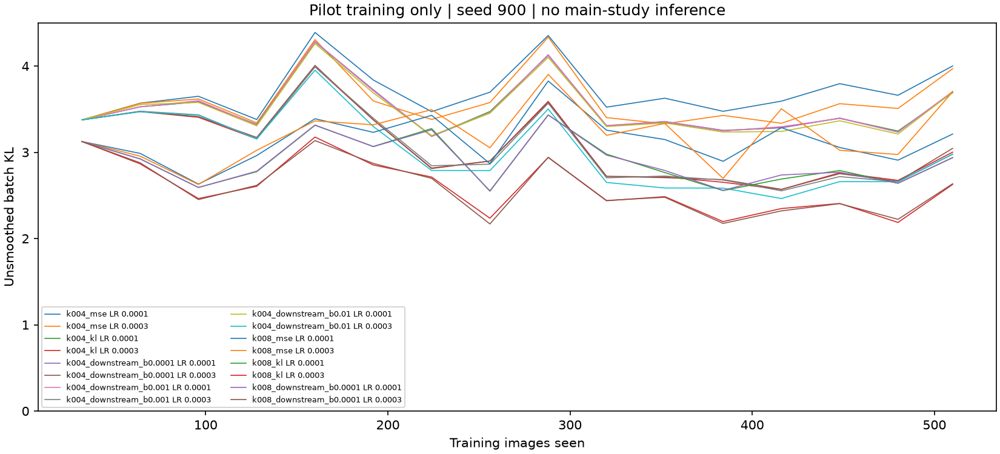
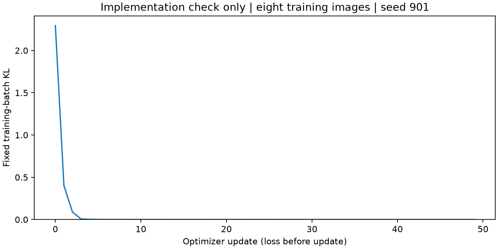

# Downstream sweep: execution status

Allocation failure before main training: 15 of 50 pilot trials completed; 1 additional trial(s) started but did not complete. No main runs or main test evaluations were performed. No LR schedule was frozen. The primary AUC, sparsity thresholds and hypothesis remain unmeasured; this does not falsify or support the directional hypothesis. Recorded stop: The original sweep stage deadline has elapsed. The original deadline was not extended.

The [registered design](../../docs/downstream-preregistration.md) remains unchanged. See [execution notes](../../docs/downstream-execution-notes.md), [all 50 pilot statuses](pilots.md), [measured evidence](results.json), and [the paper](paper.pdf).

## What is measured

Development-only pilot endpoints and training histories are available below. Completed pilot development accuracies range from 11.6% to 30.0%. Pure KL has lower development KL in 4/4 completed comparisons matched on k and learning rate. These descriptive tuning-set comparisons use pilot seed 900, are incomplete across sparsity, and provide no main-study or seed-robustness conclusion.

These are tuning data from an incomplete grid, not estimates of the primary hypothesis. No main seed-200 checkpoint, selected LR schedule, test curve, bootstrap interval, sparsity saving, k=16 map/intervention or completed study model bundle exists. The thresholds are unmeasured, not unattained.

| Cell | LR | Status | Images trained | Development KL | Development accuracy |
|---|---:|---|---:|---:|---:|
| k004_mse | 0.0001 | complete | 510 | 3.6066 | 12.40% |
| k004_mse | 0.0003 | complete | 510 | 3.42204 | 12.00% |
| k004_kl | 0.0001 | complete | 510 | 3.3338 | 14.00% |
| k004_kl | 0.0003 | complete | 510 | 2.58942 | 21.60% |
| k004_downstream_b0.0001 | 0.0001 | complete | 510 | 3.33407 | 13.60% |
| k004_downstream_b0.0001 | 0.0003 | complete | 510 | 2.60219 | 22.40% |
| k004_downstream_b0.001 | 0.0001 | complete | 510 | 3.3304 | 13.60% |
| k004_downstream_b0.001 | 0.0003 | complete | 510 | 2.58754 | 22.00% |
| k004_downstream_b0.01 | 0.0001 | complete | 510 | 3.29245 | 15.20% |
| k004_downstream_b0.01 | 0.0003 | complete | 510 | 2.44361 | 22.80% |
| k008_mse | 0.0001 | complete | 510 | 2.91783 | 13.20% |
| k008_mse | 0.0003 | complete | 510 | 3.08239 | 11.60% |
| k008_kl | 0.0001 | complete | 510 | 2.53897 | 20.00% |
| k008_kl | 0.0003 | complete | 510 | 2.21152 | 30.00% |
| k008_downstream_b0.0001 | 0.0001 | complete | 510 | 2.53986 | 22.00% |
| k008_downstream_b0.0001 | 0.0003 | trained_epoch | 510 | unmeasured | unmeasured |
| k008_downstream_b0.001 | 0.0001 | not_started | 0 | unmeasured | unmeasured |
| k008_downstream_b0.001 | 0.0003 | not_started | 0 | unmeasured | unmeasured |
| k008_downstream_b0.01 | 0.0001 | not_started | 0 | unmeasured | unmeasured |
| k008_downstream_b0.01 | 0.0003 | not_started | 0 | unmeasured | unmeasured |
| k016_mse | 0.0001 | not_started | 0 | unmeasured | unmeasured |
| k016_mse | 0.0003 | not_started | 0 | unmeasured | unmeasured |
| k016_kl | 0.0001 | not_started | 0 | unmeasured | unmeasured |
| k016_kl | 0.0003 | not_started | 0 | unmeasured | unmeasured |
| k016_downstream_b0.0001 | 0.0001 | not_started | 0 | unmeasured | unmeasured |
| k016_downstream_b0.0001 | 0.0003 | not_started | 0 | unmeasured | unmeasured |
| k016_downstream_b0.001 | 0.0001 | not_started | 0 | unmeasured | unmeasured |
| k016_downstream_b0.001 | 0.0003 | not_started | 0 | unmeasured | unmeasured |
| k016_downstream_b0.01 | 0.0001 | not_started | 0 | unmeasured | unmeasured |
| k016_downstream_b0.01 | 0.0003 | not_started | 0 | unmeasured | unmeasured |
| k032_mse | 0.0001 | not_started | 0 | unmeasured | unmeasured |
| k032_mse | 0.0003 | not_started | 0 | unmeasured | unmeasured |
| k032_kl | 0.0001 | not_started | 0 | unmeasured | unmeasured |
| k032_kl | 0.0003 | not_started | 0 | unmeasured | unmeasured |
| k032_downstream_b0.0001 | 0.0001 | not_started | 0 | unmeasured | unmeasured |
| k032_downstream_b0.0001 | 0.0003 | not_started | 0 | unmeasured | unmeasured |
| k032_downstream_b0.001 | 0.0001 | not_started | 0 | unmeasured | unmeasured |
| k032_downstream_b0.001 | 0.0003 | not_started | 0 | unmeasured | unmeasured |
| k032_downstream_b0.01 | 0.0001 | not_started | 0 | unmeasured | unmeasured |
| k032_downstream_b0.01 | 0.0003 | not_started | 0 | unmeasured | unmeasured |
| k064_mse | 0.0001 | not_started | 0 | unmeasured | unmeasured |
| k064_mse | 0.0003 | not_started | 0 | unmeasured | unmeasured |
| k064_kl | 0.0001 | not_started | 0 | unmeasured | unmeasured |
| k064_kl | 0.0003 | not_started | 0 | unmeasured | unmeasured |
| k064_downstream_b0.0001 | 0.0001 | not_started | 0 | unmeasured | unmeasured |
| k064_downstream_b0.0001 | 0.0003 | not_started | 0 | unmeasured | unmeasured |
| k064_downstream_b0.001 | 0.0001 | not_started | 0 | unmeasured | unmeasured |
| k064_downstream_b0.001 | 0.0003 | not_started | 0 | unmeasured | unmeasured |
| k064_downstream_b0.01 | 0.0001 | not_started | 0 | unmeasured | unmeasured |
| k064_downstream_b0.01 | 0.0003 | not_started | 0 | unmeasured | unmeasured |

## Implementation verification

```json
{
  "passed": true,
  "identity": {
    "cache_sha256": "e9ba9dbf9934678c992d2755e86045826f3cd824ae39bb115dd5ad735449ed40",
    "manifest_sha256": "4e9dd03404530669b54f9d78a90af3d118050c83b8d5e5433ec87184c1897d78",
    "teacher_sha256": "cfd5d6b3d19c2a6df19f3d5e299153b6dc313506f6d9e5d60e0177688af641aa",
    "model_id": "facebook/dinov3-vitb16-pretrain-lvd1689m",
    "model_revision": "5931719e67bbdb9737e363e781fb0c67687896bc",
    "bsf_revision": "219f121ea82d2b19200d1dac918396e6058d7eb9",
    "source_teacher_sha256": "357acd282d39097768b5820ab1f8b0439b2ffb1290b44b54d27e33645a3b96f3",
    "layers": [
      6,
      7,
      8,
      9,
      10,
      11,
      12
    ],
    "sequence_scope": "all_201",
    "dtype": "float32"
  },
  "images": [
    0,
    1,
    2,
    3,
    4,
    5,
    7,
    10
  ],
  "microbatch": 8,
  "cached_online_losses": [
    2.5346460342407227,
    2.5346460342407227
  ],
  "maximum_gradient_difference": {
    "B_raw": 1.7881393432617188e-07,
    "gamma": 4.842877388000488e-08
  },
  "maximum_state_difference": 0.0,
  "identity_kl": 0.0,
  "mean_replacement_kl": 4.660137176513672,
  "fixed_batch_kl": [
    2.2941360473632812,
    0.40166175365448,
    0.08897963166236877,
    0.006848917808383703,
    0.0029117814265191555,
    0.0014117860700935125,
    0.0006187388789840043,
    0.000832781835924834,
    0.0008303038193844259,
    0.0005815607728436589,
    0.0003909964580088854,
    0.00025354704121127725,
    0.0003044679469894618,
    0.00026562088169157505,
    0.00017835073231253773,
    0.00017022454994730651,
    0.0001405672519467771,
    0.00016611337196081877,
    0.00012765330029651523,
    0.000400762161007151,
    0.0003774715296458453,
    0.0004831975093111396,
    5.840065932716243e-05,
    0.00040281706606037915,
    0.00025672485935501754,
    0.0003993563586845994,
    5.429075099527836e-05,
    0.00029591613565571606,
    3.363843643455766e-05,
    0.00017929657769855112,
    0.0001628832396818325,
    8.952939242590219e-05,
    0.00012475087714847177,
    4.1949504520744085e-05,
    0.00017804007802624255,
    6.994386785663664e-05,
    0.0001328843500232324,
    3.317900700494647e-05,
    7.04038466210477e-05,
    5.4043452109908685e-05,
    2.7902839065063745e-05,
    5.379503272706643e-05,
    2.7000949557987042e-05,
    4.76399582112208e-05,
    1.3209550161263905e-05,
    4.427467501955107e-05,
    1.3676587514055427e-05,
    4.6390054194489494e-05,
    1.1910013199667446e-05,
    3.9610597013961524e-05
  ],
  "completed_unix": 1793129866.7852669
}
```

## Recorded figures





