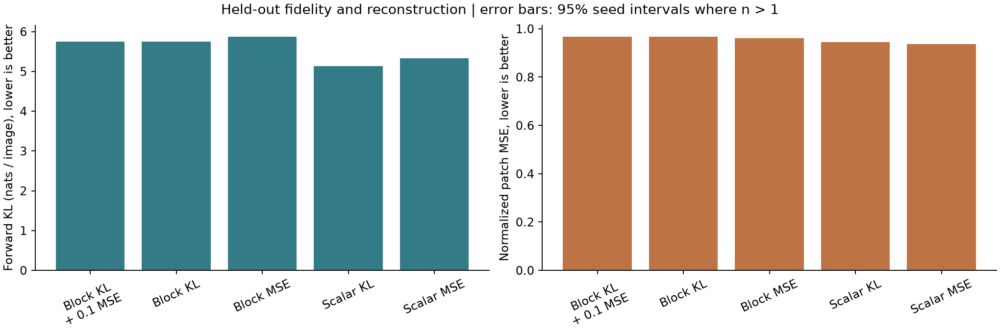
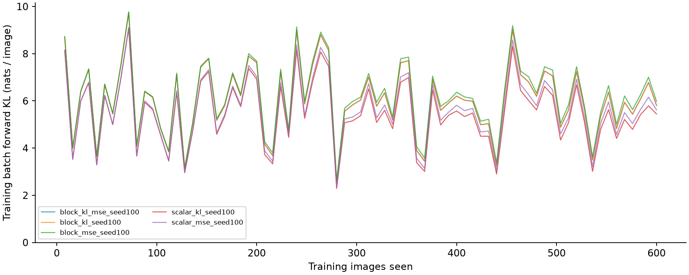
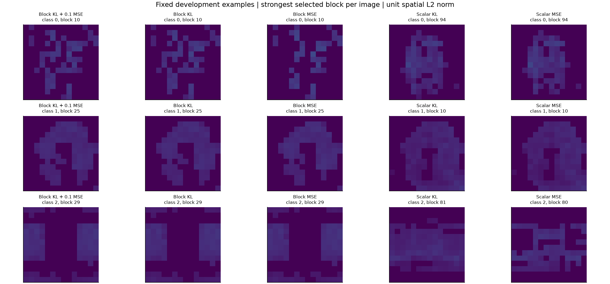

# Smoke experiment report

Engineering smoke experiment: one seed, small data and dictionary; no confirmatory claim.

Mean paired local-minus-KL difference: 0.115604 nats/image over 1 seed(s). KL training had lower mean output divergence. A seed-level confidence interval cannot be estimated from one seed.

| Condition | Seeds | Test KL (nats/image) | Accuracy | NMSE | Active blocks | Dead blocks |
|---|---:|---:|---:|---:|---:|---:|
| Block KL + 0.1 MSE | 1 | 5.75317 | 14.00% | 0.96633 | 4 | 0.00% |
| Block KL | 1 | 5.75244 | 14.00% | 0.96635 | 4 | 0.00% |
| Block MSE | 1 | 5.86805 | 10.00% | 0.96103 | 4 | 0.00% |
| Scalar KL | 1 | 5.13261 | 26.00% | 0.94416 | 12 | 0.00% |
| Scalar MSE | 1 | 5.3282 | 26.00% | 0.937 | 12 | 0.00% |

## Method and interpretation

See the [preregistration](../../docs/preregistration.md) and [source review](../../docs/literature-review.md). Only BSF parameters train, from scratch. The frozen teacher is DINOv3 plus the fitted patch classifier. Lower KL is readout fidelity, not proof of semantic concepts or preservation of all DINO representations.

## Controls

- identity: KL 0, accuracy 100.00%, NMSE 0.
- mean: KL 6.98686, accuracy 10.00%, NMSE 1.00872.
- untrained: KL 6.02086, accuracy 10.00%, NMSE 0.969882.

## Figures

## Learning and limitations

The comparison separates behavior from reconstruction. A lower output KL can coincide with higher patch MSE or degraded map structure. The ten-class head constrains at most nine logit contrasts per image. Image-group intervals describe conditional evaluation variability; seed intervals describe training variability. The pilot variance is estimated from short runs. All run metrics, settings, uncertainty and intervention outputs are in results.json.
