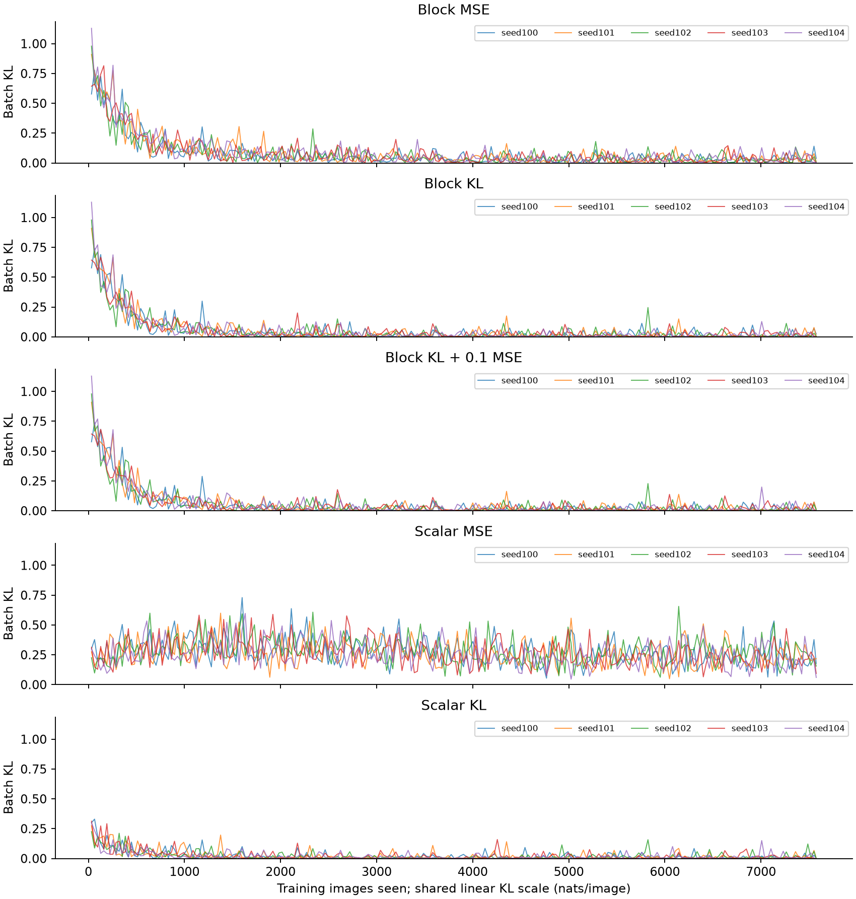

# Full experiment report

Bounded preregistered study; interpret completion and power status below. Exploratory: the pilot power target was not met.

Mean paired local-minus-KL difference: 0.00254596 nats/image over 5 seed(s). KL training had lower mean output divergence. Seed-level 95% interval: [-0.00325909, 0.008351]. The interval includes zero; the directional comparison is inconclusive.

| Condition | Seeds | Test KL (nats/image) | Accuracy | NMSE | Active blocks | Dead blocks |
|---|---:|---:|---:|---:|---:|---:|
| Block KL + 0.1 MSE | 5 | 0.0334491 | 99.27% | 0.76812 | 16 | 0.00% |
| Block KL | 5 | 0.035026 | 99.37% | 0.78728 | 16 | 0.00% |
| Block MSE | 5 | 0.0375719 | 98.49% | 0.54515 | 16 | 0.00% |
| Scalar KL | 5 | 0.0309295 | 99.05% | 0.79378 | 48 | 0.00% |
| Scalar MSE | 5 | 0.254093 | 90.74% | 0.66437 | 48 | 0.00% |

## Method and interpretation

See the [preregistration](../../docs/preregistration.md) and [source review](../../docs/literature-review.md). Only BSF parameters train, from scratch. The frozen teacher is DINOv3 plus the fitted patch classifier. Lower KL is readout fidelity, not proof of semantic concepts or preservation of all DINO representations.

## Paired primary effects

| Seed | Local KL | Proposed KL | Local minus proposed |
|---|---:|---:|---:|
| 100 | 0.0350134 | 0.037268 | -0.00225463 |
| 101 | 0.0389039 | 0.0377932 | 0.00111073 |
| 102 | 0.0407061 | 0.0320815 | 0.00862462 |
| 103 | 0.0357709 | 0.0367074 | -0.000936534 |
| 104 | 0.0374654 | 0.0312797 | 0.00618561 |

Per-run image-group bootstrap intervals are in each run report and in `primary.per_seed` in results.json. They are conditional on that trained model and do not replace seed uncertainty.

## Controls

- identity: KL 0, accuracy 99.05%, NMSE 0.
- mean: KL 3.71488, accuracy 10.17%, NMSE 0.999433.
- untrained: KL 0.734338, accuracy 72.10%, NMSE 0.776093.

## Figures

## Learning and limitations

The comparison separates behavior from reconstruction. A lower output KL can coincide with higher patch MSE or degraded map structure. The ten-class head constrains at most nine logit contrasts per image. Image-group intervals describe conditional evaluation variability; seed intervals describe training variability. The pilot variance is estimated from short runs. All run metrics, settings, uncertainty and intervention outputs are in results.json.
For completed full-study interpretation and the independent audit, see [findings](findings.md).
